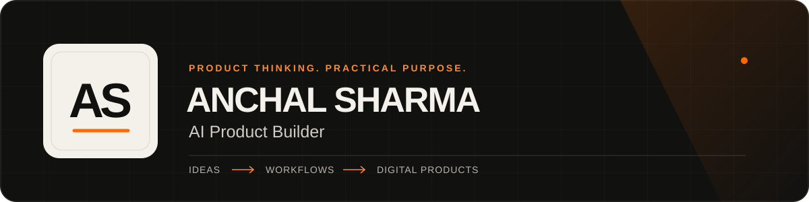

  

# Anchal Sharma

**AI Product Builder | AI Solutions | Product Management**

I shape practical business ideas into digital products through clear requirements, connected user journeys and iterative refinement. My independent projects explore retail operations, controlled business workflows and thoughtful product presentation.

I’m a B.Tech Computer Science and Engineering student at **Rayat Bahra University, Mohali**, with expected graduation in **2027**. My interests connect product thinking, AI-assisted building and business.

[Portfolio](https://anchal-sharma-portfolio.brownbloom1024.chatgpt.site/) · [Resume PDF](https://anchal-sharma-portfolio.brownbloom1024.chatgpt.site/assets/anchal-sharma-resume.pdf) · [LinkedIn](https://www.linkedin.com/in/anchal-sharma-dev/) · [Contact](https://anchal-sharma-portfolio.brownbloom1024.chatgpt.site/contact)

## Featured projects

| Project | Product focus | Explore |
| --- | --- | --- |
| **NEXORA AI OS** | A retail workspace connecting customers, inventory, sales and financial reporting. | [Source](https://github.com/anchal143744/NEXORA-AI-OS) · [Case study](https://anchal-sharma-portfolio.brownbloom1024.chatgpt.site/work?project=ai-assisted-development) · [Demo video](https://anchal-sharma-portfolio.brownbloom1024.chatgpt.site/nexora-laptop-demo.mp4) |
| **AI Operations Platform** | Customer context, human review and controlled internal workflows with a traceable execution history. | [Source](https://github.com/anchal143744/AI-Operations-Platform) · [Case study](https://anchal-sharma-portfolio.brownbloom1024.chatgpt.site/work?project=e-commerce) · [Demo video](https://anchal-sharma-portfolio.brownbloom1024.chatgpt.site/ai-operations-console-demo.mp4) |
| **Personal Portfolio** | Professional identity, product storytelling and an interactive presentation of my work. | [Source](https://github.com/anchal143744/Anchal-portfolio) · [Live website](https://anchal-sharma-portfolio.brownbloom1024.chatgpt.site/) · [Case study](https://anchal-sharma-portfolio.brownbloom1024.chatgpt.site/work?project=client-web-projects) |

The NEXORA and AI Operations demonstrations use genuine application recordings with fictional sample data. These are local product demonstrations; the links do not provide a shared, hosted application login. The portfolio website is live.

## Product focus

- **Requirements:** define the problem, intended users and feature priorities.
- **User journeys:** connect screens, workflow states and operational handoffs.
- **Interface clarity:** refine content, navigation and meaningful action labels.
- **Iteration:** review actual behaviour and improve the experience within a clear scope.

## Technologies across my projects

Project stacks include **React, Next.js, TypeScript, NestJS, Prisma, PostgreSQL, GSAP and Three.js**. My focus is on product direction, workflow planning, interface decisions and AI-assisted building.

## Let’s connect

I’m interested in early-career opportunities across AI product building, AI solutions and product management.

[Explore my work](https://anchal-sharma-portfolio.brownbloom1024.chatgpt.site/work) · [Start a conversation](https://anchal-sharma-portfolio.brownbloom1024.chatgpt.site/contact)
